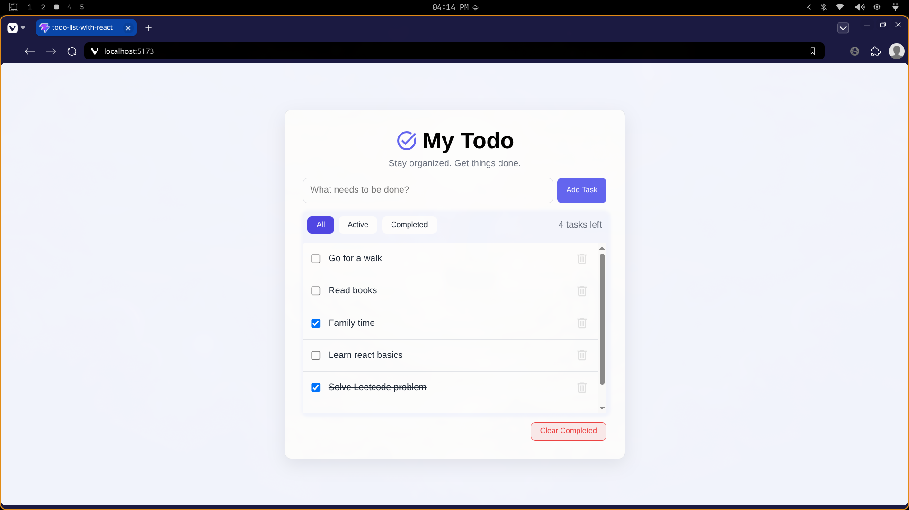

# My Todo — React Todo App

A clean, minimal todo list app built with React.



## Features

- Add new tasks via a text input
- Mark tasks as complete with a checkbox
- Delete individual tasks
- Filter tasks by **All**, **Active**, or **Completed**
- Clear all completed tasks at once
- Live count of remaining active tasks
- Persists tasks in `localStorage` so they survive page refreshes

## Tech Stack

- [React 19](https://react.dev/)
- [Vite 8](https://vite.dev/)
- ESLint with React Hooks and React Refresh plugins

## Getting Started

### Prerequisites

- Node.js 18+
- npm

### Install & Run

```bash
# Clone the repo
git clone https://github.com/yonassera/Todo-List-With-React

# GO inside the folder
cd Todo-List-With-React

# Install dependencies
npm install

# Start the dev server
npm run dev
```

Open [http://localhost:5173](http://localhost:5173) in your browser.
